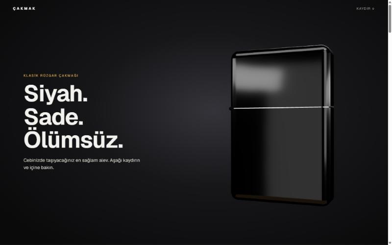
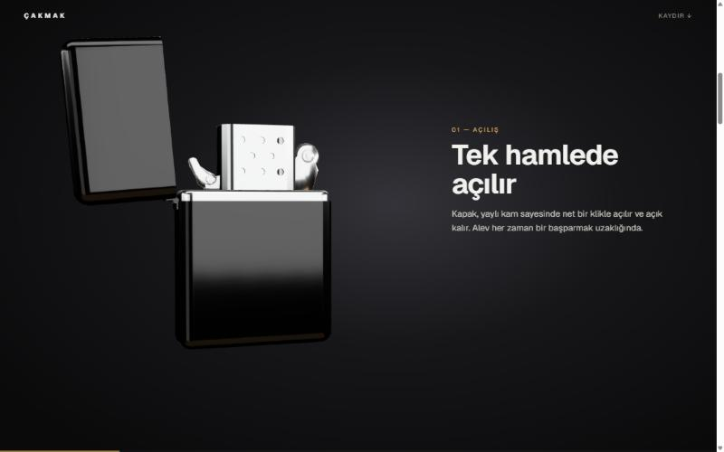
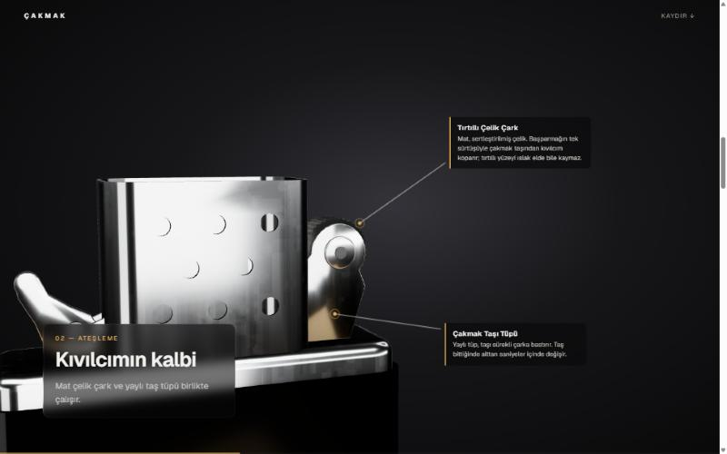
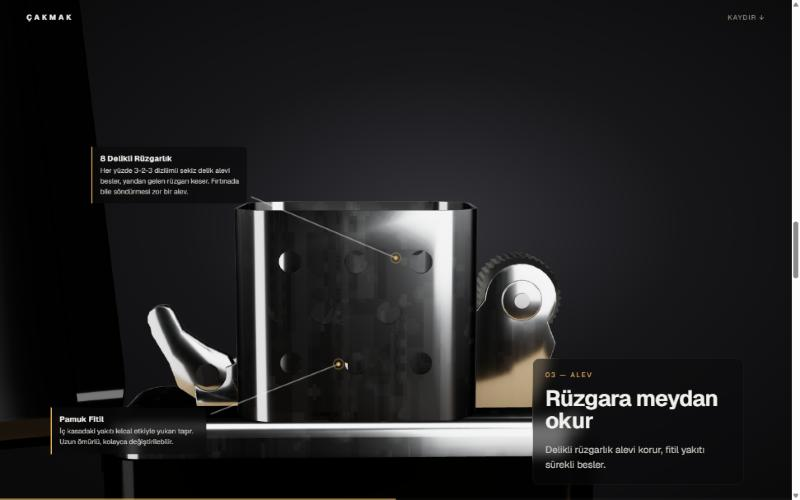
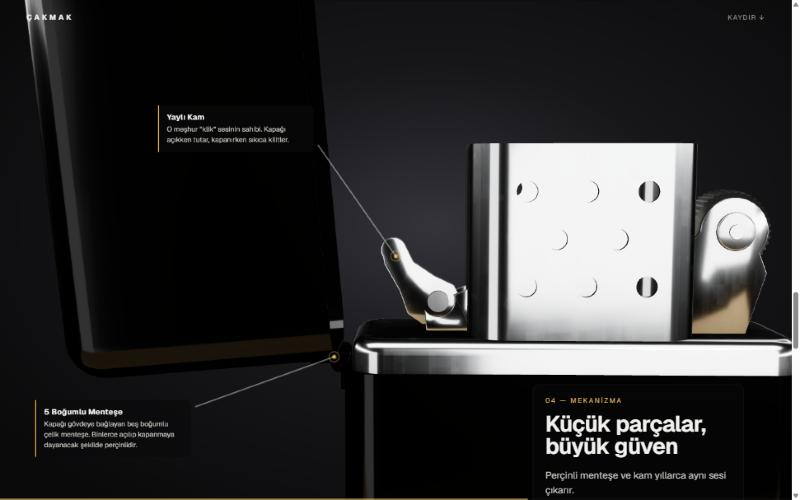
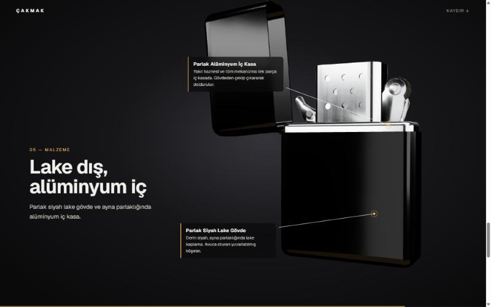

# Klasik Rüzgar Çakmağı — 3D Tanıtım Sayfası

Siyah lake gövdeli, alüminyum iç kasalı bir rüzgar çakmağını kaydırmaya bağlı 3D animasyonla tanıtan tek sayfalık site. Çakmak Blender'da modellenip boyandı ve sayfada gerçek zamanlı olarak gösteriliyor.

**Canlı site:** https://ritzykey.github.io/cakmak-site/



## Kaydırdıkça

Sayfa açıldığında çakmak sağda ve kapalıdır. Aşağı kaydırdıkça kapak açılır, çakmak sola geçer ve kamera parçalara yakınlaşıp uzaklaşır. Yakın planlarda parçanın üzerinden bir çizgi uzanır ve ucunda o parçanın açıklaması belirir.

| | |
|---|---|
|  |  |
| **Tek hamlede açılır:** Kapak açılır, çakmak sola kayar. | **Kıvılcımın kalbi:** Çarka yakınlaşma; çark ve taş tüpü etiketleri. |
|  |  |
| **Rüzgara meydan okur:** 8 delikli rüzgarlık ve fitil. | **Küçük parçalar, büyük güven:** Menteşe ve yaylı kam. |



Son bölümde çakmak ortada bir tur dönerek kapanır.

## Çalıştırma

```bash
npm install
npm run dev
```

Ardından tarayıcıda http://localhost:3000 adresini açın. Üretim derlemesi için `npm run build` ve `npm start`.

## Teknolojiler

- [Next.js](https://nextjs.org) 16 (App Router)
- [three.js](https://threejs.org), [React Three Fiber](https://r3f.docs.pmnd.rs) ve [drei](https://drei.docs.pmnd.rs)
- Model: Blender'da modellenip dokusu bake edilmiş, armatürlü GLB (`public/models/cakmak.glb`)

## Proje yapısı

| Dosya | İçerik |
|---|---|
| `src/lib/content.ts` | Bölüm metinleri, parça açıklamaları ve her bölümün kamera/çakmak anahtar kareleri |
| `src/components/Scene.tsx` | 3D sahne: model, ışıklar, kaydırmaya bağlı animasyon, etiket konumları |
| `src/components/LighterExperience.tsx` | Sayfa düzeni, bölümler, etiket katmanı ve kaydırma takibi |
| `public/models/cakmak.glb` | Çakmak modeli (`Kapak` ve `Cark` kemikleri animasyonda kullanılır) |

Metinleri veya kamera hareketlerini değiştirmek için genelde yalnızca `src/lib/content.ts` dosyasını düzenlemek yeterlidir.
